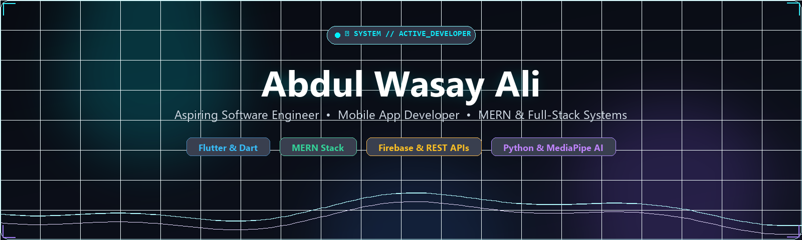

  

    

  

  

    
    &nbsp;
    
    &nbsp;
    
    &nbsp;
    
  

  

---

### About Me

I'm **Abdul Wasay Ali** — an aspiring Software Engineer and tech enthusiast based in Karachi, Pakistan. 

Currently pursuing a Diploma in Software Engineering alongside Intermediate studies at **Aptech Computer Education (SBTE)**. I specialize in building performant cross-platform mobile apps with **Flutter & Dart**, as well as architecting modern data-driven web applications with the **MERN stack** (MongoDB, Express.js, React.js, Node.js).

- **Focus Areas:** Cross-Platform Mobile Architecture, Reactive State Management, RESTful API Engineering, Full-Stack Web Development.
- **Current Goals:** Seeking impactful software engineering internships, collaborative open-source opportunities, and production-level development roles.
- **Mission:** Engineering elegant, scalable, and human-centric software solutions that solve real-world problems.

---

### Education

- **Diploma in Software Engineering** *(2024 – 2027)*  
  Aptech Computer Education, Shahrah-e-Faisal *(Continuing)*

- **Intermediate** *(2026 – 2027)*  
  Aptech Computer Education, Shahrah-e-Faisal · SBTE (Sindh Board of Technical Education) *(Continuing)*

- **Matriculation — Science Group (Biology)** *(2020 – 2021)*  
  Dehli Government Boys Secondary School, Karachi

---

### Core Expertise

- **Mobile App Development**
  - Flutter & Dart (Cross-platform, high-performance responsive UI)
  - Firebase Authentication, Cloud Firestore, Cloud Storage & REST API Consumption
  - Provider State Management & Clean Architecture

- **Full-Stack & MERN Stack Development**
  - MongoDB & Mongoose ORM
  - Express.js & Node.js (RESTful API Design, JWT Auth)
  - React.js (Component architecture, Custom Hooks, State management)
  - HTML5, CSS3, JavaScript (ES6+), Bootstrap, Tailwind CSS

- **Backend & Other Frameworks**
  - Python & R Programming
  - PHP & Laravel Framework
  - ASP.NET MVC & C# (.NET Framework)
  - Relational Databases: MySQL & Microsoft SQL Server

---

### Technologies & Tools

  &nbsp;
  &nbsp;
  &nbsp;
  &nbsp;
  &nbsp;
  &nbsp;
  &nbsp;
  &nbsp;
  &nbsp;
  &nbsp;
  

  &nbsp;
  &nbsp;
  &nbsp;
  &nbsp;
  &nbsp;
  &nbsp;
  &nbsp;
  &nbsp;
  &nbsp;
  &nbsp;
  

---

### Featured Projects

#### Pakistan Sign Language (PSL) Translator App
> *A Flutter-based intelligent mobile application for real-time Pakistan Sign Language translation using MediaPipe hand tracking and LSTM sequence models. Designed to eliminate communication barriers for Pakistan's hearing-impaired community.*

- **Highlights:** Real-time sign-to-text recognition, on-device gesture tracking, low-latency API integration.
- **Technologies:** `Flutter` `Dart` `Python` `FastAPI` `MediaPipe` `TensorFlow`

#### Full-Stack & MERN Web Applications
> *Robust, responsive, and scalable full-stack web applications engineered with modern component architectures, secure RESTful APIs, and optimized database models.*

- **Highlights:** Role-based authentication, dynamic state orchestration, CRUD workflows, responsive UI.
- **Technologies:** `React.js` `Node.js` `Express.js` `MongoDB` `JavaScript` `Tailwind CSS` `Bootstrap` `Laravel` `MySQL`

---

### GitHub Activity & Telemetry

  

 

  
  &nbsp;&nbsp;
  

 

  

---

### Connect with Me

  
  &nbsp;&nbsp;
  
  &nbsp;&nbsp;
  
  &nbsp;&nbsp;
  

