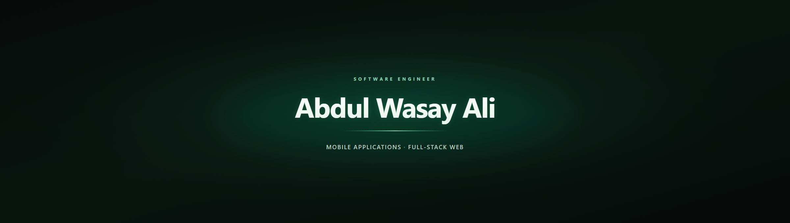
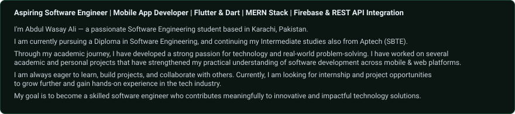
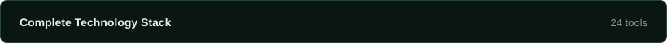
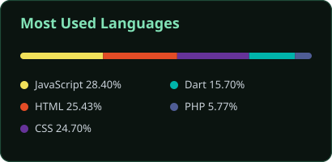

  

  
  
  
  

---

## About Me

---

## Tools & Technologies

Your complete stack stays together in one compact icon section, without repeating it in long bullet lists.

  

---

## GitHub Activity

Your public GitHub activity and language distribution, shown in the same emerald theme.

  
  

The real contribution graph remains visible on your GitHub profile below the README.

---

## Education

Your complete academic path, clearly presented.

---

<em>"Always eager to learn, build, and collaborate."</em>

