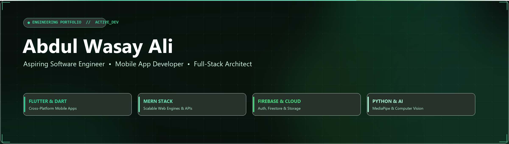

  

  
  
  
  

---

### About

> Software Engineering student building accessible mobile products and modern, data-driven web applications.

Based in **Karachi, Pakistan**, I design and develop responsive digital experiences with **Flutter & Dart** for mobile and the **MERN stack** for the web. I enjoy turning practical problems into clean, scalable products with thoughtful user experiences.

**Current Focus**

- Building a [Pakistan Sign Language (PSL) Translator App](https://github.com/AbdulWasayAli) to help make communication more accessible.
- Developing cross-platform mobile applications, RESTful APIs, reactive interfaces, and full-stack web platforms.

**Open To**

- Software Engineering internships and meaningful product collaborations.
- Conversations about Flutter, Dart, React, Node.js, Express, MongoDB, Firebase, and accessible technology.

Focused on building useful, reliable, and scalable digital solutions.

---

### 🛠️ Tech Stack & Technologies

  &nbsp;
  &nbsp;
  &nbsp;
  &nbsp;
  &nbsp;
  &nbsp;
  &nbsp;
  &nbsp;
  &nbsp;
  &nbsp;
  

  &nbsp;
  &nbsp;
  &nbsp;
  &nbsp;
  &nbsp;
  &nbsp;
  &nbsp;
  &nbsp;
  &nbsp;
  &nbsp;
  

---

### 🚀 Featured Projects

#### 📱 Pakistan Sign Language (PSL) Translator App
> *An intelligent real-time translation mobile application bridging accessibility gaps for Pakistan's hearing-impaired community.*

- **Overview:** Real-time sign-to-text translation using machine learning & computer vision models.
- **Tech Stack:** `Flutter` `Dart` `Python` `FastAPI` `MediaPipe` `TensorFlow`

#### 🌐 Full-Stack & MERN Applications
> *Scalable, responsive web applications engineered with modern component architectures and secure RESTful APIs.*

- **Overview:** Dynamic state orchestration, secure role-based authentication, and optimized MongoDB/MySQL data models.
- **Tech Stack:** `React.js` `Node.js` `Express.js` `MongoDB` `JavaScript` `Tailwind CSS` `Laravel` `MySQL`

---

### 📊 GitHub Activity & Analytics

  
  &nbsp;&nbsp;
  

 

  

---

### 🎓 Education

- **Diploma in Software Engineering** *(2024 – 2027)*  
  Aptech Computer Education, Shahrah-e-Faisal *(Continuing)*

- **Intermediate** *(2026 – 2027)*  
  Aptech Computer Education, Shahrah-e-Faisal · SBTE (Sindh Board of Technical Education) *(Continuing)*

- **Matriculation — Science Group (Biology)** *(2020 – 2021)*  
  Dehli Government Boys Secondary School, Karachi

---

  <i>"Always eager to learn, build, and collaborate."</i>

